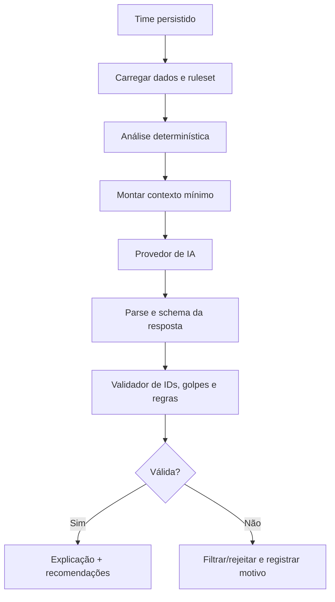

# Estratégia de integração da IA

## 1. Princípio

A IA é uma camada de interpretação e recomendação dentro do Team Builder. Ela não é a fonte de verdade para tipos, existência de Pokémon, existência de golpes, limites do time ou legalidade de um formato.

Na Etapa 8, a integração está implementada no módulo `apps/api/src/ai` e no Team Builder. O restante deste documento descreve os mesmos princípios de segurança e validação usados pela implementação.

## 2. Contexto enviado pelo backend

O backend deve construir um contexto mínimo e explícito a partir do time persistido e de dados validados:

```json
{
  "team": {
    "id": "internal-id",
    "format": "casual",
    "members": [
      {
        "position": 1,
        "species": { "id": 25, "slug": "pikachu", "formSlug": "pikachu" },
        "types": ["electric"],
        "moves": [{ "id": 84, "slug": "thunder-shock" }]
      }
    ]
  },
  "analysis": {
    "weaknesses": [{ "type": "ground", "multiplier": 2 }],
    "resistances": [],
    "coverage": {}
  },
  "ruleset": { "name": "casual-v1", "constraints": [] }
}
```

Não enviar tokens, e-mails, dados de outros usuários, payload bruto desnecessário da PokéAPI ou histórico completo de conversas. A preparação deve normalizar nomes, remover campos desconhecidos e limitar tamanho.

## 3. Separação entre determinismo e interpretação

### Determinístico no backend

- Identidade e existência do Pokémon/golpe.
- Tipos, estatísticas disponíveis e evoluções consultadas.
- Limites de seis membros e quatro golpes.
- Efetividade de tipos.
- Regras do formato e legalidade conhecida.
- Validação de IDs e referências.

### Interpretativo pela IA

- Explicação em linguagem natural.
- Priorização de lacunas estratégicas.
- Alternativas de Pokémon ou moveset já existentes no catálogo validado.
- Perguntas de esclarecimento quando o objetivo do usuário não for claro.

O prompt deve instruir o modelo a escolher somente de listas fornecidas pelo backend. Mesmo assim, a saída será tratada como não confiável até passar pelo validador.

## 4. Formato de recomendação futura

Preferir resposta estruturada, por exemplo:

```json
{
  "recommendations": [
    {
      "kind": "pokemon",
      "speciesId": 130,
      "formId": 130,
      "reasonCodes": ["covers_ground_weakness"],
      "explanation": "Texto curto e compreensível"
    }
  ],
  "warnings": [],
  "ruleset": "casual-v1"
}
```

Se o provedor retornar JSON inválido, IDs inexistentes, golpes fora do catálogo ou combinações incompatíveis, o backend rejeita ou remove o item inválido e informa que a recomendação não pôde ser confirmada. Não exibir recomendação como válida apenas porque veio do modelo.

## 5. Pipeline de validação



## 6. Segurança, custos e falhas

- A chave do provedor fica somente no backend e em secret manager/variáveis protegidas.
- O frontend nunca escolhe livremente o modelo, o endpoint ou o orçamento.
- Aplicar autenticação, rate limit por usuário, limite diário e timeout.
- Definir tamanho máximo de contexto e de resposta.
- Não persistir prompts completos por padrão; se houver logging para auditoria, remover dados pessoais e controlar retenção.
- Tratar indisponibilidade com mensagem estável e permitir que o Team Builder continue funcionando sem IA.
- Registrar métricas de latência, erro, tokens/custo e taxa de rejeição da validação.
- Começar com um provedor e uma interface interna (`AiProvider`) para manter possibilidade de troca sem espalhar SDK pelo domínio.

## 7. Dependências de regras

Para recomendações competitivas, PokéAPI sozinha não é suficiente. Antes da versão 2.0, avaliar fontes de legalidade, learnsets por geração/formato e regras de Pokémon Showdown, incluindo atualização, licença e compatibilidade com o produto. A decisão deve gerar um documento próprio de `ruleset` antes de prometer validação competitiva.
