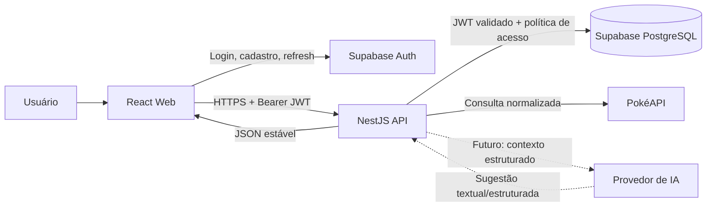

# Arquitetura geral

## 1. Visão do produto

O PokéLab será uma aplicação web que combina uma Pokédex pública com um Team Builder autenticado. A consulta da Pokédex não exige login; a criação e a persistência de times exigem uma sessão válida. A IA ficará dentro do Team Builder e será acionada sobre um contexto estruturado do time, nunca diretamente pelo navegador.

O desenho recomendado é um monólito modular no backend, dentro de um monorepo. Ele mantém baixo custo operacional no começo e preserva fronteiras suficientes para separar módulos quando o produto crescer.

## 2. Decisões obrigatórias e recomendações

| Tipo | Decisão | Motivo e impacto futuro |
|---|---|---|
| Obrigatória | Backend NestJS é a única porta para dados próprios e para a PokéAPI | Centraliza autenticação, normalização, limites, logs e tratamento de falhas |
| Obrigatória | O navegador nunca recebe segredos do Supabase ou da IA | Evita acesso administrativo e abuso de custos |
| Obrigatória | Times pertencem ao usuário autenticado | Permite RLS e garante isolamento entre usuários |
| Obrigatória | API versionada em `/api/v1` | Evita quebrar clientes quando contratos evoluírem |
| Obrigatória | Pokémon são referenciados externamente, não copiados integralmente no banco | Reduz duplicação e facilita atualização da PokéAPI |
| Recomendada | Monorepo com npm workspaces | Compartilha contratos e documentação sem introduzir infraestrutura adicional |
| Recomendada | Prisma no backend | Migrações explícitas, tipagem e boa ergonomia para PostgreSQL |
| Recomendada | TanStack Query no frontend | Cache, loading, erro e invalidação de consultas remotas ficam consistentes |
| Recomendada | DTOs do NestJS com class-validator/class-transformer | Valida entrada no limite da API e mantém o backend como autoridade |
| Opcional posterior | Zustand | Só deve entrar se o estado local do Team Builder ultrapassar React state/context e ficar difícil de manter |
| Não recomendado no MVP | Redis, microserviços, fila, event bus e catálogo próprio completo | Aumentam operação antes de existir necessidade mensurável |

## 3. Papel de cada tecnologia

| Tecnologia | Papel |
|---|---|
| React | Componentes, páginas e interação da interface |
| TypeScript | Tipagem estática no frontend, backend e contratos |
| Vite | Servidor de desenvolvimento e build do frontend |
| Tailwind CSS | Sistema de estilos utilitário e responsivo |
| shadcn/ui | Componentes acessíveis e customizáveis, mantidos no código do projeto |
| React Router | Rotas públicas, rotas autenticadas e navegação |
| TanStack Query | Cache e sincronização de dados vindos da API |
| NestJS | Módulos, controllers, casos de uso, autenticação e integração externa |
| API REST | Contrato explícito entre frontend e backend |
| Supabase Auth | Cadastro, login, logout, refresh e emissão de JWT |
| Supabase PostgreSQL | Persistência dos perfis e times, com RLS |
| Prisma | Modelo de dados, migrações e acesso tipado ao PostgreSQL |
| PokéAPI | Fonte de dados gerais de espécies, formas, tipos, habilidades, evoluções e golpes |
| Provedor de IA futuro | Interpretação e explicação de recomendações, sempre atrás do backend |

## 4. Comunicação entre os componentes



### Responsabilidades

- **React Web:** apresenta dados e coleta intenção do usuário. Não decide propriedade, limites ou validade final.
- **Supabase Auth:** autentica a pessoa e mantém a sessão no cliente por meio do SDK oficial. O JWT é enviado ao backend.
- **NestJS API:** valida o JWT, aplica autorização, consulta o PostgreSQL, chama a PokéAPI, normaliza respostas e aplica regras.
- **PostgreSQL:** guarda somente dados próprios do produto no MVP. RLS reforça o isolamento dos times.
- **PokéAPI:** fornece dados gerais externos. Indisponibilidade deve produzir erro controlado ou resposta parcial, sem corromper o time salvo.
- **IA:** recebe apenas o contexto necessário e nunca acessa o banco diretamente. A resposta passa por validação determinística antes de ser exibida.

## 5. Monorepo recomendado

O projeto deve usar monorepo porque frontend, backend, contratos e documentação evoluirão juntos. `npm workspaces` é suficiente no começo: evita adicionar uma ferramenta de gerenciamento adicional sem benefício concreto.

```text
pokelab/
├─ apps/
│  ├─ web/                         # React, Vite e interface do produto
│  └─ api/                         # NestJS, REST, casos de uso e integrações
├─ packages/
│  ├─ contracts/                   # Tipos/schemas compartilhados quando necessário
│  └─ config/                      # Somente configurações compartilhadas justificadas
├─ docs/                           # Decisões e contratos arquiteturais
├─ infra/                          # Migrações, seeds e configuração não secreta
├─ .env.example                    # Nomes de variáveis, sem valores reais
├─ package.json                    # Workspaces e scripts de orquestração
└─ README.md
```

### Organização interna do frontend

```text
apps/web/src/
├─ app/                            # Bootstrap, providers e composição de rotas
├─ routes/                         # Páginas por rota
├─ features/
│  ├─ pokedex/                     # Busca, filtros, lista e detalhe
│  ├─ team-builder/                # Editor de time, slots, golpes e análise
│  └─ auth/                        # Login, cadastro e sessão
├─ components/                     # Componentes visuais reutilizáveis
├─ lib/                            # Cliente HTTP, Supabase client e utilitários
├─ hooks/                          # Hooks de apresentação e consulta
├─ styles/                         # Tokens e estilos globais
└─ types/                          # Tipos locais não compartilhados
```

### Organização interna do backend

```text
apps/api/src/
├─ main.ts                         # Bootstrap HTTP
├─ app.module.ts                   # Composição dos módulos
├─ config/                         # Configuração e validação de ambiente
├─ common/                         # Erros, guards, decorators, pipes e respostas
├─ auth/                           # Validação do JWT e contexto do usuário
├─ profiles/                       # Perfil mínimo vinculado ao Auth
├─ pokemon/                        # Consulta, normalização e integração com PokéAPI
├─ teams/                          # Casos de uso e endpoints de times
├─ team-analysis/                  # Análise determinística de tipos
├─ ai/                             # Futuro; isolado do fluxo principal
└─ database/                       # Prisma client e repositórios
```

Cada módulo deve seguir o fluxo `controller -> application/use case -> domain rules -> repository/integration`. Não é necessário criar uma camada para cada abstração possível: a separação serve para manter domínio, persistência e integrações substituíveis.

## 6. Fluxos principais

### Autenticação

1. O usuário se cadastra ou entra pelo Supabase Auth.
2. O Supabase emite access token e refresh token; o SDK mantém a sessão conforme sua configuração.
3. O frontend envia o access token no header `Authorization: Bearer <token>` às rotas privadas.
4. O NestJS valida assinatura, expiração e claims do JWT.
5. O backend usa o `sub` do token como identidade; nunca aceita `user_id` vindo do corpo.
6. O perfil local pode ser criado de forma idempotente no primeiro acesso autenticado.
7. Logout invalida a sessão no cliente pelo Supabase Auth. A autorização no backend continua exigindo token válido.

### Consulta de Pokémon

1. O frontend chama o backend com filtros de nome, número, tipo ou geração.
2. O backend valida e limita paginação/filtros.
3. O módulo `pokemon` chama a PokéAPI, normaliza o resultado para o contrato próprio e trata ausência/indisponibilidade.
4. O frontend recebe somente o modelo necessário para a tela; não fica acoplado ao formato bruto da PokéAPI.
5. Cache HTTP ou cache de aplicação pode ser adicionado depois, sem alterar o contrato público.

### Salvamento de equipe

1. O usuário monta ou edita um rascunho no Team Builder.
2. O frontend envia uma operação válida para o backend.
3. O backend obtém o usuário pelo JWT, valida nome, slots, referências e golpes.
4. O backend grava time, Pokémon e golpes em transação.
5. Restrições SQL e, quando necessário, trigger/lock de banco garantem os limites mesmo sob concorrência.
6. A resposta retorna o recurso persistido. O frontend invalida a consulta da lista e do detalhe.

## 7. Segurança e observabilidade mínima

- Variáveis secretas ficam somente no ambiente do backend; `.env.example` contém nomes e exemplos não sensíveis.
- O frontend pode usar a chave pública/anon do Supabase, nunca a service role key.
- RLS deve ser habilitado nas tabelas com dados de usuário.
- Para operações de usuário, escolher antes da implementação uma estratégia que preserve o contexto JWT no acesso ao banco: Supabase client/PostgREST com o token do usuário, ou uma transação PostgreSQL que injete esse contexto. Se Prisma usar uma conexão administrativa sem contexto, os repositórios devem exigir `ownerId` derivado do token como filtro obrigatório; isso não deve ser descrito como RLS aplicado diretamente.
- O backend deve validar origem/CORS, payloads, tamanho de requisição e rate limit básico em endpoints públicos e caros.
- Logs não devem registrar JWT, refresh token, senha, chave de IA ou payloads sensíveis completos.
- Erros externos devem ser convertidos para mensagens estáveis, sem vazar stack trace ou credenciais.
- Antes de produção, adicionar monitoramento de erros e métricas de latência; não é bloqueante para o primeiro fluxo local.
