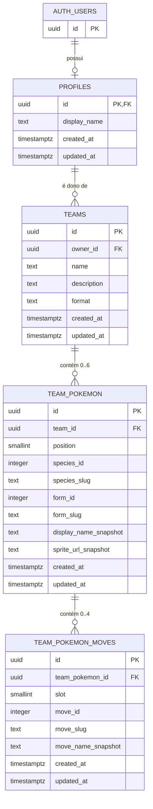

# Modelo inicial do banco de dados

## 1. Princípio de persistência

No MVP, o PostgreSQL armazena o estado criado pelo usuário e referências mínimas aos dados externos. A Pokédex completa continua na PokéAPI. Isso evita duplicar milhares de registros e reduz o problema de sincronização.

O backend deve persistir identificadores estáveis e alguns snapshots de apresentação usados para manter o histórico legível. Um snapshot não substitui a referência externa nem deve ser usado para afirmar que os dados competitivos continuam atuais.

## 2. Entidades do MVP

### `profiles`

Representa a extensão mínima do usuário autenticado. A identidade principal continua em `auth.users` do Supabase.

| Campo | Tipo PostgreSQL | Regras |
|---|---|---|
| `id` | `uuid` | PK; igual a `auth.users.id` |
| `display_name` | `text` | Opcional; tamanho máximo definido pela API |
| `avatar_url` | `text` | Opcional; URL de apresentação, nunca usada para autorização |
| `created_at` | `timestamptz` | Obrigatório; default `now()` |
| `updated_at` | `timestamptz` | Obrigatório; atualizado em alterações |

Relacionamento: `auth.users (1) -> profiles (0..1)`. O perfil não deve ser criado com um UUID arbitrário.

### `teams`

| Campo | Tipo PostgreSQL | Regras |
|---|---|---|
| `id` | `uuid` | PK; default `gen_random_uuid()` |
| `owner_id` | `uuid` | FK para `profiles.id`; obrigatório; não editável pelo cliente |
| `name` | `text` | Obrigatório; trim; 1 a 80 caracteres |
| `description` | `text` | Opcional; limite de tamanho |
| `format` | `text` | Obrigatório; default `casual`; enum lógico no MVP |
| `created_at` | `timestamptz` | Obrigatório; default `now()` |
| `updated_at` | `timestamptz` | Obrigatório; atualizado em alterações |

Restrições:

- `owner_id` deve existir em `profiles`.
- `format` começa com `casual`; outros formatos são extensão futura, não devem ser aceitos apenas porque o cliente enviou texto diferente.
- Exclusão usa `ON DELETE CASCADE` para os filhos do time.

Índices:

- `teams_owner_id_updated_at_idx (owner_id, updated_at desc)` para a lista do usuário.
- Índice opcional em `format` somente quando houver mais de um formato persistido.

### `team_pokemon`

Representa uma posição do time e a referência a uma espécie/forma.

| Campo | Tipo PostgreSQL | Regras |
|---|---|---|
| `id` | `uuid` | PK; default `gen_random_uuid()` |
| `team_id` | `uuid` | FK para `teams.id`; obrigatório; cascade |
| `position` | `smallint` | Obrigatório; `CHECK position between 1 and 6` |
| `species_id` | `integer` | Identificador numérico da espécie na PokéAPI; positivo |
| `species_slug` | `text` | Slug estável da espécie; obrigatório |
| `form_id` | `integer` | Opcional; identificador da forma na PokéAPI |
| `form_slug` | `text` | Opcional; obrigatório quando `form_id` for informado |
| `display_name_snapshot` | `text` | Nome exibido no momento da gravação |
| `sprite_url_snapshot` | `text` | Opcional; URL de apresentação, nunca usada como autorização |
| `created_at` | `timestamptz` | Obrigatório; default `now()` |
| `updated_at` | `timestamptz` | Obrigatório; atualizado em alterações |

Restrições e índices:

- `UNIQUE (team_id, position)` impede duas entradas no mesmo slot.
- `CHECK (species_id > 0)` e, quando informado, `CHECK (form_id > 0)`.
- `INDEX (team_id)` para detalhe e exclusão do time.
- `UNIQUE` de espécie não é aplicado no MVP casual. Duplicatas podem ser sinalizadas por um validador futuro de formato.

### `team_pokemon_moves`

Representa os golpes configurados para uma entrada específica do time.

| Campo | Tipo PostgreSQL | Regras |
|---|---|---|
| `id` | `uuid` | PK; default `gen_random_uuid()` |
| `team_pokemon_id` | `uuid` | FK para `team_pokemon.id`; obrigatório; cascade |
| `slot` | `smallint` | Obrigatório; `CHECK slot between 1 and 4` |
| `move_id` | `integer` | Identificador do golpe na PokéAPI; positivo |
| `move_slug` | `text` | Slug estável do golpe; obrigatório |
| `move_name_snapshot` | `text` | Nome exibido no momento da gravação |
| `created_at` | `timestamptz` | Obrigatório; default `now()` |
| `updated_at` | `timestamptz` | Obrigatório; atualizado em alterações |

Restrições e índices:

- `UNIQUE (team_pokemon_id, slot)` impede dois golpes no mesmo slot.
- `UNIQUE (team_pokemon_id, move_id)` evita o mesmo golpe duplicado no mesmo Pokémon no MVP.
- `INDEX (team_pokemon_id)` para carregamento do detalhe.
- Limite máximo de quatro linhas por `team_pokemon_id` deve ser garantido também por regra transacional no backend e trigger/função no banco.

## 3. Diagrama entidade-relacionamento

## 4. Limites de seis Pokémon e quatro golpes

A defesa deve existir em duas camadas:

1. **Aplicação:** o caso de uso carrega o estado atual, valida o comando e realiza a operação em uma transação. Erros retornam `409 Conflict` quando o limite é atingido.
2. **Banco:** uma função/trigger ou procedimento transacional conta as linhas do pai e rejeita inserções acima do limite. A operação deve usar bloqueio apropriado da linha do time para impedir duas requisições concorrentes de passarem na mesma verificação.

`position` e `slot` também limitam o espaço válido, mas sozinhos não impedem seis posições já ocupadas mais uma inserção concorrente; por isso a proteção de contagem é necessária.

## 5. RLS e segurança dos dados

RLS deve ser habilitado em `profiles`, `teams`, `team_pokemon` e `team_pokemon_moves`.

- `profiles`: o usuário só lê e atualiza o próprio perfil.
- `teams`: o usuário só seleciona, insere, atualiza e remove linhas cujo `owner_id = auth.uid()`.
- `team_pokemon`: acesso permitido somente quando o `team_id` pertence ao usuário autenticado.
- `team_pokemon_moves`: acesso permitido somente quando o Pokémon pai pertence a um time do usuário.

Para operações de usuário, escolher antes da implementação uma estratégia que preserve o contexto JWT no acesso ao banco: Supabase client/PostgREST com o token do usuário, ou uma transação PostgreSQL que injete esse contexto. Se Prisma usar uma conexão administrativa sem contexto, os repositórios devem exigir `ownerId` derivado do token como filtro obrigatório; isso deve ser tratado como defesa de aplicação, não como RLS aplicado diretamente. A service role key, se necessária para tarefas administrativas futuras, fica isolada em jobs confiáveis e nunca é enviada ao frontend.

## 6. Dados que deliberadamente ficam fora do MVP

Não criar ainda tabelas para itens, naturezas, EVs, IVs, habilidades selecionáveis, formatos competitivos, compartilhamento, favoritos, times públicos ou catálogo completo da PokéAPI. O modelo mantém espaço para adicioná-los sem transformar o time atual em uma estrutura incompatível:

- `format` já identifica o contexto de regras.
- `species_id` e `form_id` separam espécie de forma.
- golpes são filhos, podendo receber campos de contexto competitivo posteriormente.
- novos campos de build podem ser adicionados ao Pokémon do time ou a tabelas próprias sem reescrever a propriedade do time.
